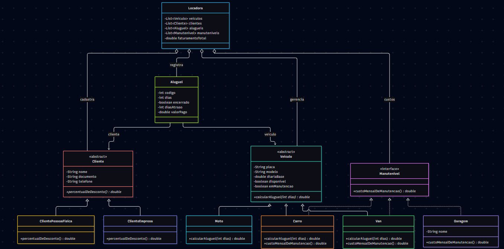

# Projeto POO - Grupo 6 - Locadora de veículos
## Integrantes
1. iaguitotop - iaguitosdev.for@gmail.com
2. hansel-oliveira - hanseloliveira27@gmail.com
3. jamesexesilva-hash - jamesexesilva@gmail.com
4. kirliepoc - nicolascpessoal@gmail.com
5. nicolascpessoal-stack - iagosales96171@gmail.com

## 1. Como executar
1. Clone o repositório: `git clone <https://github.com/iaguitotop/poo-2026-2-grupo-6>`
2. Abra o projeto na sua IDE (IntelliJ / Eclipse / VS Code) configurado com **Java 17+**.
3. Execute o método `main` da classe `app.Main`.

## 2. Diagrama de Classes

## 3. Divisão de Tarefas (Quem fez o quê)
## Iago A.

**Classes:** Locadora, Aluguel e Cliente (abstrata)

**Responsabilidades:**
- Locadora com as listas e o método de valor total.
- Aluguel com seus atributos e a ligação com Cliente e Veiculo.
- Cliente com nome, documento e telefone. Integra tudo no final.

## Iago S.

**Classes:** ClientePessoaFisica e ClienteEmpresa

**Responsabilidades:**
- Herdam de Cliente e implementam `percentualDeDesconto()`.

## Hansel

**Classes:** Veiculo (abstrata) e Moto

**Responsabilidades:**
- Veiculo com placa, modelo, diária e disponibilidade, e `calcularAluguel(int dias)`.
- Moto implementa só o cálculo do aluguel.

## James

**Classes:** Carro e Van

**Responsabilidades:**
- Herdam de Veiculo e implementam Manutenivel.

## Nicolas

**Classes:** Manutenivel (interface) e Garagem

**Responsabilidades:**
- A interface com `custoMensalDeManutencao()`.
- A Garagem com o atributo nome, implementando a interface.

## 4. Declaração de Uso de IA
